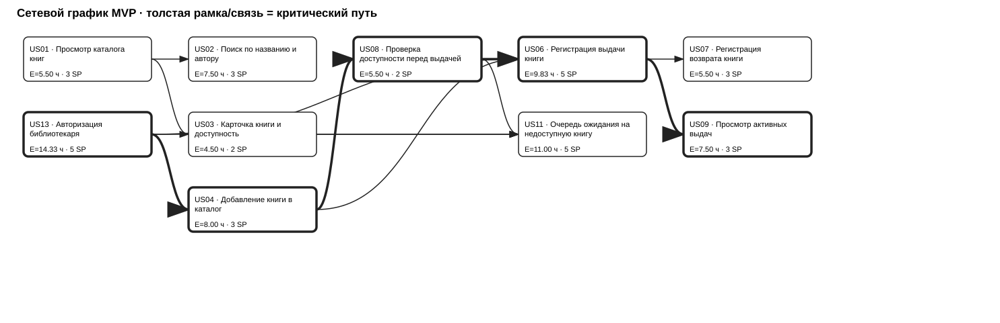

# План релиза, сетевой график и прогноз

## Цель и исходные данные
Цель — проверить зависимости MVP, определить критический путь и оценить вероятность завершения к предварительной дате защиты ЛР3. Плановая дата защиты в исходном задании не указана; в расчётах принято **28 декабря 2026 года**. Её необходимо заменить, если преподаватель объявит другую дату.

- Старт планирования реализации: 3 ноября 2026 года.
- Горизонт: 8 недель.
- MVP: 10 историй, 34 SP.
- Суммарная ожидаемая трудоёмкость по PERT: 79,17 фокусированных человеко-часа.
- Расчётная ёмкость команды: 89,6 фокусированных человеко-часа.

## Зависимости MVP
- US01 → US02 и US03.
- US13 → US04.
- US04 → US08.
- US04, US08 и US13 → US06.
- US06 → US07 и US09.
- US03, US08 и US13 → US11.

US05, US10, US12, US14, US15, US16 и US17 не входят в MVP и не влияют на его критический путь.

## Сетевой график
На рисунке толстая рамка и толстые связи показывают критический путь. Длительность каждой истории — ожидаемая оценка PERT в фокусированных человеко-часах; график не учитывает ограничения доступности конкретного участника и поэтому дополняется резервом на координацию и интеграцию.

Критический путь: **US13 → US04 → US08 → US06 → US09**.

| ID | История | E, ч | Ранний старт, ч | Раннее завершение, ч | Поздний старт, ч | Позднее завершение, ч | Резерв, ч |
|---|---|---:|---:|---:|---:|---:|---:|
| US01 | Просмотр каталога книг | 5.50 | 0.00 | 5.50 | 24.17 | 29.67 | 24.17 |
| US02 | Поиск по названию и автору | 7.50 | 5.50 | 13.00 | 37.67 | 45.17 | 32.17 |
| US03 | Карточка книги и доступность | 4.50 | 5.50 | 10.00 | 29.67 | 34.17 | 24.17 |
| US13 | Авторизация библиотекаря | 14.33 | 0.00 | 14.33 | 0.00 | 14.33 | 0.00 |
| US04 | Добавление книги в каталог | 8.00 | 14.33 | 22.33 | 14.33 | 22.33 | 0.00 |
| US08 | Проверка доступности перед выдачей | 5.50 | 22.33 | 27.83 | 22.33 | 27.83 | 0.00 |
| US06 | Регистрация выдачи книги | 9.83 | 27.83 | 37.67 | 27.83 | 37.67 | 0.00 |
| US07 | Регистрация возврата книги | 5.50 | 37.67 | 43.17 | 39.67 | 45.17 | 2.00 |
| US09 | Просмотр активных выдач | 7.50 | 37.67 | 45.17 | 37.67 | 45.17 | 0.00 |
| US11 | Очередь ожидания на недоступную книгу | 11.00 | 27.83 | 38.83 | 34.17 | 45.17 | 6.33 |

Результирующая таблица автоматически формируется командой `python scripts/pert_cpm.py` и сохраняется в `data/cpm_results.csv`. Значения в CSV — исходный воспроизводимый результат CPM.

Ожидаемая длительность критического пути по PERT — около 45,17 фокусированных человеко-часа. Нулевой резерв у US13, US04, US08, US06 и US09 означает, что задержка любой из этих историй сдвигает расчётное завершение зависимого пути, если не принять корректирующие меры.

## Вероятность завершения по PERT
Для оценки вероятности к дате используется консервативное сравнение суммарной трудоёмкости с доступным командным бюджетом:
- ожидаемая суммарная трудоёмкость MVP: `μ = 79,17 ч`;
- суммарное стандартное отклонение при допущении независимости оценок: `σ ≈ 5,93 ч`;
- доступный бюджет: `T = 89,6 ч`;
- `z = (T − μ) / σ = (89,6 − 79,17) / 5,93 ≈ 1,76`;
- по нормальному приближению PERT вероятность `P(работа ≤ T) ≈ 96,1%`.

Это модельная вероятность по оценкам, а не гарантия. Она не учитывает изменение требований, задержку ревью, болезни и технические проблемы. Поэтому сохраняется резерв ёмкости, а в ЛР4 прогноз нужно обновить по фактическим данным.

## Прогноз Монте-Карло
До появления собственной истории используется синтетическая последовательность пропускной способности (историй в неделю): `1, 2, 3, 4, 2, 3, 1, 4`. Она сохранена в `data/throughput_history.csv` и **не является фактической историей команды**.

Скрипт 100 000 раз выбирает недельную пропускную способность из этого набора с возвращением и считает, за сколько недель будут завершены 10 историй.

| Перцентиль | Прогноз, недель | Плановая дата от 03.11.2026 |
|---|---:|---|
| P50 | 4 | 1 декабря 2026 |
| P85 | 5 | 8 декабря 2026 |
| P95 | 6 | 15 декабря 2026 |

Среднее моделируемое время — около 4,40 недели. P50 означает, что в половине симуляций работа завершается за 4 недели или быстрее; P85 — за 5 недель или быстрее. Модель учитывает только число историй в неделю, но не их размер и зависимости, поэтому это первичный прогноз, а не замена CPM.

Пересчёт: `python scripts/monte_carlo.py`. Скрипт сохраняет сводку и распределение в `data/monte_carlo_summary.csv` и `data/monte_carlo_distribution.csv`.

## Риски и действия
1. **Задержка US13/US04/US08/US06/US09:** начать с каркаса авторизации и модели книги; фиксировать блокировки.
2. **Задержка ревью:** ограничить колонку Review одной историей; ревьюер берёт её первой.
3. **Изменение даты защиты:** обновить `data/project_config.json` и повторить прогноз.
4. **Недостаточная фактическая пропускная способность:** после 3–4 недель заменить синтетические данные на реальные завершённые истории и повторить Монте-Карло.
5. **Невыполнимость полного MVP:** пересмотреть необязательный объём; US11 — первый кандидат на исключение, если ограничение ёмкости подтвердится.

## Вывод
По текущим предположениям MVP укладывается в плановый горизонт с расчётным резервом. Критический путь проходит через авторизацию, добавление книги, проверку доступности, выдачу и список активных выдач. Монте-Карло даёт P85 на 8 декабря, но прогноз нужно обновить по реальной пропускной способности команды.
